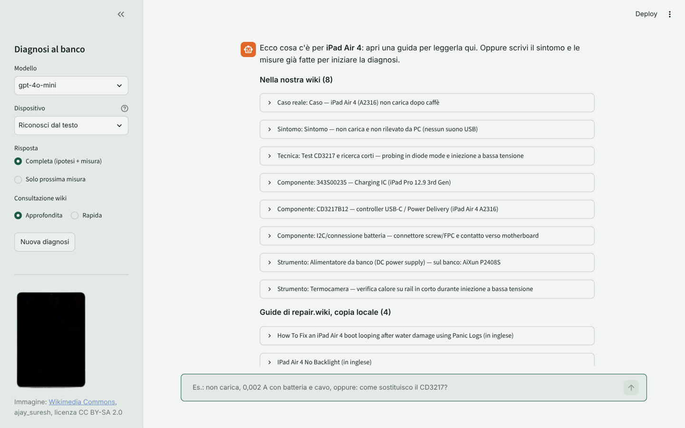
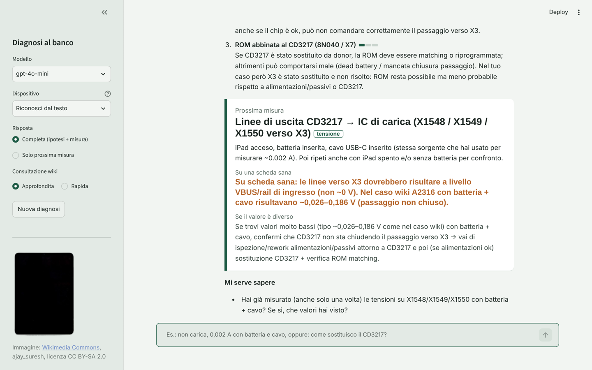
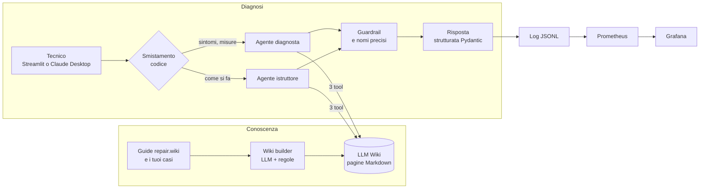
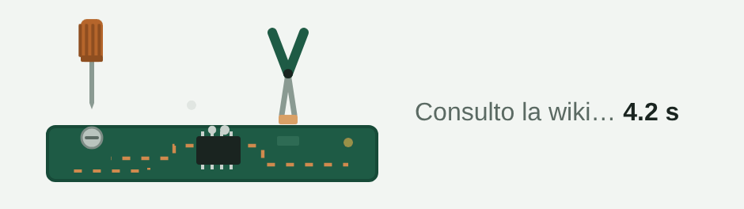

# Diagnosi al banco

**Un assistente per chi ripara schede di iPhone e iPad.** Gli descrivi il guasto e le misure già fatte; lui ti dice
**una misura alla volta**: dove mettere i puntali, in che condizioni, che valore trovi su una scheda sana e cosa
significa se il valore è diverso. Ogni risposta cita le pagine da cui viene.

Scritto da un riparatore di terzo livello (microsaldatura), come progetto personale della AITHO GenAI Academy,
con [datapizza-ai](https://github.com/datapizza-labs/datapizza-ai) 0.1.0.

> *In English:* a board-level repair assistant for iPhone/iPad technicians. It reads a local knowledge base built from
> repair.wiki guides and your own cases (an "LLM Wiki", not RAG), and answers with **one measurement at a time**:
> where to probe, under which conditions, the expected value on a healthy board, and its sources. Two agents
> (diagnosis and step-by-step procedures), deterministic safety guardrails, MCP server for Claude Desktop,
> Prometheus/Grafana dashboard. The UI and the knowledge base are in Italian.



## Cosa fa

- **Diagnosi guidata.** Riepilogo, ipotesi in ordine di probabilità, **una** prossima misura con il valore su scheda
  sana. Ricorda le misure della sessione e non ti fa rifare quelle già fatte.
- **Procedure passo per passo.** "Come sostituisco il CD3217 e programmo la ROM?" → passi in ordine, con attrezzo
  e controllo per ognuno. Risponde un secondo agente, scelto dal codice, non dall'LLM.
- **Scrivi solo il modello** ("A2316", "iPad Air 4") → scheda del dispositivo con foto e tutte le sue guide,
  apribili nell'app e traducibili in italiano. **0 token.**
- **Guardrail di sicurezza**, deterministici: blocca istruzioni pericolose (corto sulla batteria, calore vicino alla
  batteria), ricorda il limite di corrente, segnala valori impossibili e sigle mai viste nelle fonti, toglie le fonti
  non lette.
- **Nomi precisi dei chip.** "X3" da solo non dice niente senza lo schema aperto: diventa
  "343S00264-A0 (X3 su JC Drawing)".
- **Dentro Claude Desktop** tramite un server **MCP**.
- **Osservabile.** Ogni risposta è registrata (token, secondi, costo in euro, tool usati, guardrail) e si vede su
  **Grafana**.



## Perché

Le informazioni per riparare una scheda ci sono, ma sono sparse: guide online, schemi, boardview, esperienza.
Un LLM generico risponde con sicurezza ma **inventa le sigle e non cita niente**. Stessa domanda sul mio caso reale
(iPad Air 4 A2316, non carica dopo un caffè), stesso modello:

| | Senza la wiki | Con la wiki e il mio caso |
|---|---|---|
| Sospettato principale | generico ("Uxxxx") | **CD3217B12**, controller USB-C/PD |
| Prossima misura | consigli validi per qualsiasi iPad | **X1548–X1550**, con e senza batteria |
| Fonti | 0 | 5 pagine citate |

## Come funziona



- **LLM Wiki invece di RAG** (schema di Karpathy): un LLM legge le guide e scrive pagine collegate per
  dispositivo, componente, sintomo, tecnica e strumento. Le pagine si leggono e si **correggono a mano**.
- **Gli agenti** (datapizza `Agent`) leggono da soli indice e pagine con tre tool: `leggi_indice`, `cerca_wiki`,
  `leggi_pagina`. Rispondono con uno schema Pydantic (`PassoDiagnosi`, `PassoBreve`, `Procedura`).
- **Regola del progetto:** all'LLM solo quello che solo lui sa fare. Smistamento, guardrail, nomi dei chip, elenco
  delle guide: codice normale, testato senza chiave.

## Installazione

Serve Python 3.11+ e una chiave OpenAI (oppure Anthropic).

```powershell
git clone https://github.com/<utente>/diagnosi-schede.git
cd diagnosi-schede
python -m venv .venv
.\.venv\Scripts\Activate.ps1          # macOS/Linux: source .venv/bin/activate
pip install -r requirements.txt
pip install -e .
copy .env.example .env                # macOS/Linux: cp .env.example .env
```
Apri `.env` e incolla la chiave dopo `OPENAI_API_KEY=` (o `ANTHROPIC_API_KEY=` con `PROVIDER=anthropic`), senza spazi
né virgolette. Se l'app dice "OPENAI_API_KEY mancante", la riga è vuota: salva il file e riavvia Streamlit.

Verifica che sia tutto a posto (i test non usano la chiave):
```powershell
pytest -q
```

## Uso

### Interfaccia
```powershell
streamlit run app/streamlit_app.py
```
A sinistra scegli il dispositivo (o lascia che lo riconosca dal testo), il tipo di risposta (completa o solo la
prossima misura) e la lettura della wiki (approfondita o rapida, meno token). Poi scrivi, per esempio:

- `A2316` → scheda dell'iPad Air 4 e le sue guide
- `Non carica, il PC non lo rileva. Con batteria e cavo prende 0,002 A; senza batteria 5,2 V e 0,11–0,20 A, niente PD.`
- `Come sostituisco il CD3217 e programmo la ROM?`

### Da terminale
```powershell
python scripts/chat_diagnosi.py           # sessione interattiva, 'esci' per finire (--breve, --rapida)
```

### In Claude Desktop (MCP)
```powershell
python -m diagnosi.mcp_server                   # stdio
$env:MCP_HTTP=1; python -m diagnosi.mcp_server  # HTTP stateless su http://localhost:8000/mcp
```
Tool: `cerca_caso(sintomo, modello)`, `componente_info(sigla)`, `suggerisci_misura(contesto)` (agente + guardrail).
Resource: `wiki://indice`, `wiki://{tipo}/{nome}`. Prompt: `diagnosi_guidata`.
Configurazione d'esempio: `materiali/claude_desktop_config.example.json`. Prova come farebbe un host:
`python scripts/prova_mcp.py`.

### Dashboard Grafana
Serve Docker Desktop acceso. Su Windows basta un doppio clic su **`avvia_osservabilita.bat`**. A mano:
```powershell
python -m diagnosi.metriche                      # exporter: http://localhost:8001/metrics
cd observability ; docker compose up -d          # Prometheus (:9090) + Grafana (:3000)
```
Grafana: http://localhost:3000 → "Diagnosi schede — agente e guardrail". Costo stimato in euro: prezzi del tuo
modello e cambio nel `.env` (`PREZZO_INPUT_USD_1M`, `PREZZO_CACHE_USD_1M`, `PREZZO_OUTPUT_USD_1M`, `CAMBIO_USD_EUR`).
Per fermare: `docker compose down`.



## Aggiungi i tuoi casi

La wiki diventa davvero utile con **i tuoi** casi. Scrivi un file Markdown in `raw/casi/`, per esempio
`raw/casi/iphone-12-non-si-accende.md`, con:

- **modello e codice** (es. iPhone 12, A2403);
- **sintomi** e cosa è successo prima (caduta, liquido, riparazione precedente);
- **misure** con le **condizioni** (con/senza batteria, cavo, acceso/spento) e lo **schema** da cui vengono le sigle
  (es. "X3 su JC Drawing = 343S00264-A0");
- **interventi fatti** e risultato, separati dai **sospetti**.

Poi:
```powershell
python -m diagnosi.wiki_builder raw/casi      # l'LLM aggiorna le pagine giuste e scrive wiki/log.md
python -m diagnosi.lint_wiki                  # link rotti, pagine senza fonti, pagine orfane
```
**Rileggi le pagine toccate:** l'LLM può sbagliare (è successo: aveva scritto che un chip era stato sostituito quando
non lo era). Le correzioni a mano restano.

### Ricostruire la wiki da zero
1. Da https://repair.wiki/w/Special:Export esporta le categorie *Apple Phones*, *Apple Tablets*, *Repair Basics* e
   *Repair guide* (solo revisione attuale) e salva i `.xml` in `raw/repairwiki/`.
2. Poi:
```powershell
python -m diagnosi.import_repairwiki raw/repairwiki/*.xml      # 274 guide iPhone/iPad in Markdown, con attribuzione
python -m diagnosi.crea_dispositivi                            # pagine dei dispositivi (senza LLM)
python -m diagnosi.wiki_builder raw/repairwiki/pagine --max 3  # prova su 3 guide, poi senza --max
python scripts/traduci_guide.py ipad-air-4                     # facoltativo: guide di un modello in italiano
python scripts/scarica_immagini.py --anche-simili              # facoltativo: foto con licenza libera da Wikimedia
```
Per le immagini è consigliato un token personale Wikimedia (`WIKIMEDIA_TOKEN` nel `.env`, istruzioni in testa
allo script).

## Sicurezza e limiti

- È un **assistente per tecnici esperti**, non un sostituto dell'esperienza: verifica sempre sigle e valori sullo
  schema e sulla boardview del tuo modello.
- Batterie Li-ion: niente corti, niente calore vicino alla batteria, alimentatore da banco **con limite di corrente**.
  I guardrail aiutano, ma la responsabilità al banco è tua.
- La base di conoscenza copre iPhone e iPad (Apple). Le informazioni di un modello non valgono automaticamente per
  un altro: la wiki e i prompt lo trattano esplicitamente.

## Struttura

| Cartella | Contenuto |
|---|---|
| `raw/` | fonti: guide repair.wiki importate (e tradotte), i tuoi casi, il tuo banco |
| `wiki/` | la LLM Wiki: `index.md`, `log.md`, `dispositivi/`, `casi/`, `componenti/`, `sintomi/`, `tecniche/`, `strumenti/`, `fonti/` |
| `src/diagnosi/` | agenti, schemi, prompt, guardrail, nomi precisi, tool della wiki, builder, server MCP, metriche |
| `app/` | interfaccia Streamlit e immagini dei dispositivi |
| `scripts/` | punti di avvio (chat da terminale, traduzioni, immagini, prova MCP) |
| `observability/` | Prometheus + Grafana con la dashboard già pronta |
| `docs/` | confronti con e senza wiki, log delle sessioni |
| `tests/` | pytest: 57 test, nessuno usa la chiave |

Regole della wiki e del codice: [AGENTS.md](AGENTS.md).

## Crediti e licenze

- **Codice:** licenza MIT, vedi [LICENSE](LICENSE).
- **Guide di [repair.wiki](https://repair.wiki):** CC BY-SA 3.0. Ogni file importato o tradotto riporta fonte e
  autori; le traduzioni sono indicate come opere modificate con la stessa licenza.
- **Immagini dei dispositivi:** Wikimedia Commons, solo licenze libere; autore e licenza di ciascuna in
  `app/immagini/CREDITI.md`.
- Costruito con [datapizza-ai](https://github.com/datapizza-labs/datapizza-ai), Streamlit, il protocollo MCP,
  Prometheus e Grafana, durante la AITHO GenAI Academy.

Hai un caso da aggiungere o hai trovato un errore nella wiki? Apri una issue: le correzioni dei tecnici sono la parte
più preziosa del progetto.
